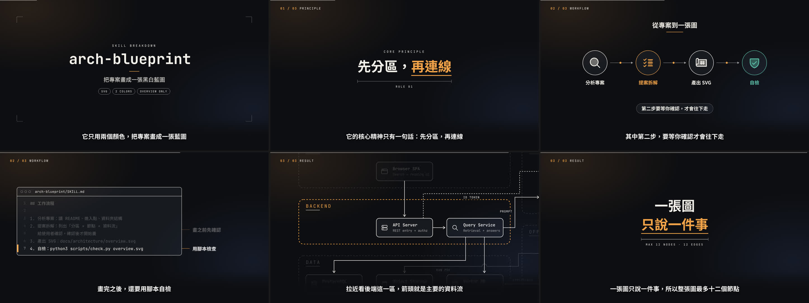

# arch-video

你想向其他工程師介紹一個專案的架構，但做一支解說影片要整理內容、寫腳本、畫圖、配音、對時間。這個 repo 是兩個 Claude Code skill：一個把專案整理成帶出處的素材，一個把素材做成有旁白、字幕和章節的 1080p 影片。



- **旁白帶動畫面**：每句旁白先合成語音、量出秒數，畫面上的元素在旁白講到它之前就出現。
- **十三種場景元件**：對話、對比卡片、清單、大數字、檔案樹、終端機、流程、循環、架構圖等，你只填內容，版面與動畫是現成的。
  其中「版面」元件可以把格子、時間格、長條、小流程、示意視窗這些零件組合在同一個畫面，用來畫數量、進度與狀態的變化。
- **架構圖會自己畫出來**：直接讀 [arch-blueprint](https://github.com/cholateio/arch-blueprint) 產出的 SVG，逐區拉近講解，再沿著連線把資料流一條一條走過。
- **分鏡寫錯會先告訴你**：旁白裡找不到觸發詞、字幕超過一行、場景開場空白太久、元素比旁白晚出現，都會在渲染前報出來。

- **影片只講素材裡有的**：內容一律來自審核過的素材。分鏡的每個場景要寫出它根據素材的哪幾條，對不到、或那一條的原因不明，產片指令會報錯。
- **一件事講完才換下一件**：專案同時做好幾件事時，影片一條故事線走到底再換下一條，換線時先講一句兩者的關係；外部服務的背景在第一次用到的地方交代。
- **講原因，不只報告現況**：影片的主體是幾個關鍵的決定，每個決定講當初的問題、怎麼選、為什麼、不這樣會怎樣。原因要有出處（註解、設計紀錄、commit 訊息），查不到就不講。
- **機密不會被唸出來**：送出配音之前先掃描分鏡，發現疑似金鑰、內部位址或電子郵件就停下來。

另一個 skill `arch-material` 負責影片之前的那一步：把專案整理成素材。

- **素材放在專案外面**：一個專案一個檔，集中在你自己的素材庫，不在專案裡多出任何檔案。
- **每一句都指得回去**：素材是一句一句的主張，各自附上出處的位置；檢查程式會確認每個位置真的指得到東西。
- **原因與背景都要找齊**：每個決定整理成一條因果弧；外部服務的行為與限制上網查官方文件，記下來源與日期，之後別的專案也能用。
- **改了程式不用手動維護**：素材記著整理時的版本，要用之前才比對，只重新查證受影響的那幾條。

設計時主要的對象是 skill、MCP server 與中小型的程式專案；Windows 上還沒有完整測試過。

## How it works

```
專案 ──► 素材（arch-material，你審核）──► 編排 ──► 分鏡檔

分鏡檔 ──► 逐句配音 ──► 時間軸 ──► 合成 HTML ──► 渲染 mp4
              └─► 每句的秒數與字詞時間，決定畫面元素何時出現
```

沒有伺服器也沒有資料庫；除了配音以外，全部在你的電腦上完成。

## Install

你需要 Node.js 22 以上，以及 ffmpeg。

1. 下載這個 repo，進入 `skill` 資料夾。
2. 執行 `npm install`。
3. 執行 `node scripts/arch-video.mjs doctor`，它會告訴你還缺什麼。
4. 執行 `npm run demo`，示範片會出現在 `out/demo/demo.mp4`。第一次會自動下載渲染用的無頭 Chrome。

要讓 Claude Code 替你從一個 repo 做出影片，把兩個資料夾放在同一層：`skill` 複製成 `~/.claude/skills/arch-video`，
`skill-material` 複製成 `~/.claude/skills/arch-material`（它不需要 `npm install`）。然後分兩步：

1. 對 Claude Code 說「整理這個專案的素材」。素材會寫到 `~/arch-material/`，不會動你的專案；
   它整理完會先給你看主旨、每個決定的原因和查不到的問題，你確認後才算審核過。
2. 再說「把這個專案做成架構解說影片」。它會先給你看編排（講哪幾件事、照什麼順序、講深哪些決定），
   再給你看腳本和每個場景的預覽圖，你放行後才渲染。素材還沒整理、沒審核，或專案在那之後改過，它會停下來請你先回第 1 步。

編排、分鏡與影片放在 `~/arch-material/video/<專案>/`。

要自己寫分鏡，複製 `examples/demo/storyboard.json` 來改，格式見 `references/storyboard-format.md`，
然後執行 `node scripts/arch-video.mjs build <你的分鏡檔>`。分鏡的 `meta.material` 寫素材庫裡的專案名稱；示範片不講真實專案，所以寫的是 `false`。

## Privacy & security

- 渲染、字型、圖示都在本機，不需要任何金鑰或帳號。
- 整理素材時對你的專案只讀；素材庫建立時設成只有你的帳號讀得到。上網查背景知識時，查詢只包含公開的服務與技術名稱。
- 旁白的文字會送到 Microsoft Edge 的朗讀服務合成語音；合成結果快取在 `skill/.cache/`，同一句不會重送。
- HyperFrames 預設會回傳使用統計，這個專案的指令一律把它關閉，也不使用任何會上傳專案或影片的指令。

## License

[MIT](LICENSE). 渲染使用 [HyperFrames](https://github.com/heygen-com/hyperframes) 與 GSAP，圖示來自 [Phosphor Icons](https://phosphoricons.com)，字型是 JetBrains Mono 與 Noto Sans TC，配音經由 node-edge-tts。
